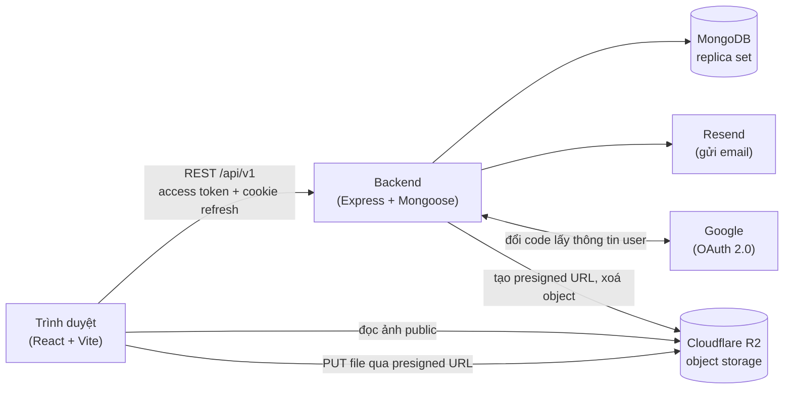
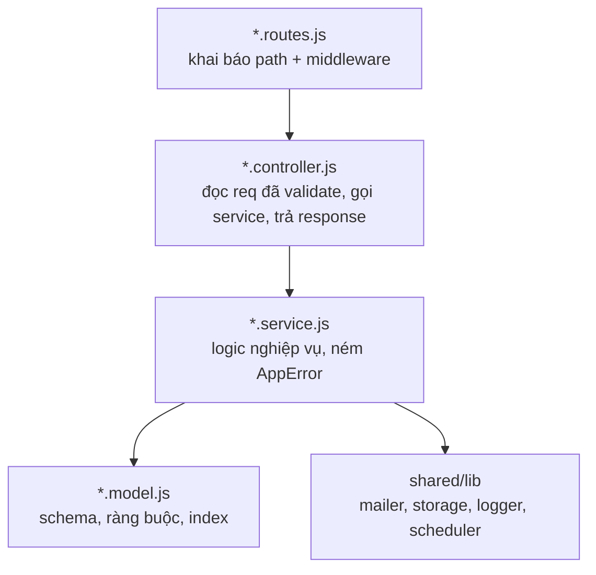
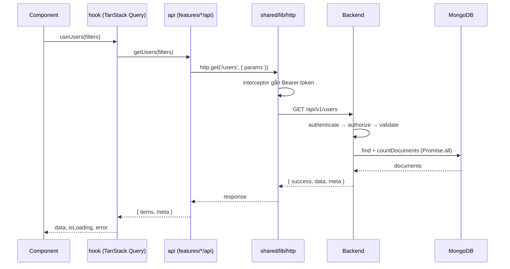

# 01 — Kiến trúc tổng thể

## Bức tranh chung

Điểm đáng chú ý: **file không đi qua backend**. Trình duyệt PUT thẳng lên R2 bằng
URL có chữ ký. Backend nhẹ hơn và không bị giới hạn kích thước body, nhưng phải
kiểm soát chặt ở bước cấp URL vì sau đó không chặn được gì nữa.

## Ranh giới tầng ở backend

Quy tắc không được vi phạm:

| Tầng | Được làm | Không được làm |
|---|---|---|
| `routes` | Khai báo path, gắn `authenticate` / `authorize` / `validate` | Chứa logic nghiệp vụ |
| `controller` | Đọc `req.body/params/query` (đã parse), gọi service, gọi helper response | Truy vấn DB, kiểm tra quyền nghiệp vụ, tự viết `res.status().json()` |
| `service` | Logic nghiệp vụ, gọi model và lib, ném `AppError` | Đụng tới `req`/`res`, biết về HTTP |
| `model` | Định nghĩa dữ liệu, index | Logic nghiệp vụ, gọi API ngoài |
| `shared/*` | Dùng chung cho nhiều module | Import ngược từ `modules/*` |

**Module không import model của module khác.** Cần dữ liệu thì gọi service được
export. Ví dụ: `auth.service` cần tạo phiên → gọi `sessions.service.createSession()`,
không import `SessionModel`.

## Bản đồ module backend

| Module | Trách nhiệm | Phase |
|---|---|---|
| `health` | `GET /health` kiểm tra cả DB | 0 |
| `users` | Model User, hồ sơ, đổi role, chặn/mở chặn | 1, 5, 11 |
| `auth` | Đăng ký, đăng nhập, verify email, magic link, Google OAuth, mật khẩu | 2, 4 |
| `sessions` | Phiên đăng nhập, refresh rotation, thu hồi | 3 |
| `settings` | Cấu hình hệ thống (singleton), bật/tắt phương thức đăng nhập | 4 |
| `media` | Presigned upload, thư viện, thư mục, ảnh mồ côi | 7, 11, 12 |
| `scheduler` | Job định kỳ, lịch sử chạy | 13 |

## Luồng dữ liệu một request điển hình

Component **không bao giờ** gọi `axios` trực tiếp. Chuỗi đúng luôn là
`component → hook → api → http`.

## Phân vai state ở frontend

| Loại | Công cụ | Ví dụ trong dự án |
|---|---|---|
| Dữ liệu từ API | TanStack Query | danh sách user, media, job, cấu hình |
| Client state toàn cục | Zustand | phiên đăng nhập (`authStore`) |
| State cục bộ | `useState` | modal đang mở, ẩn/hiện mật khẩu |
| State của form | react-hook-form | mọi form |
| Bộ lọc, trang hiện tại | URL search params | `?page=2&role=ADMIN` |
| Sở thích cá nhân | localStorage | chế độ xem lưới/danh sách |

Lỗi cần tránh: copy dữ liệu API vào Zustand rồi tự đồng bộ. Query đã lo cache,
refetch, loading và error.

## Những điểm yếu đã biết của kiến trúc này

Ghi lại để không ai kỳ vọng sai:

1. **Scheduler chạy in-process.** Deploy nhiều instance sẽ khiến job chạy trùng.
   Cần queue (BullMQ + Redis) hoặc khoá phân tán khi scale ngang.
2. **Cache cấu hình trong bộ nhớ** (30 giây). Nhiều instance thì mỗi instance có
   bản cache riêng, thay đổi cấu hình lan chậm.
3. **Kiểm tra session mỗi request** thêm một truy vấn DB cho mỗi lời gọi API.
   Đây là cái giá để thu hồi phiên có tác dụng ngay; có thể cache về sau.
4. **Tìm ảnh mồ côi là N+1 query** theo lô. Chấp nhận được vì chạy nền; nếu
   thư viện lớn thì đổi sang gom `distinct` cho mỗi consumer rồi trừ tập hợp.
