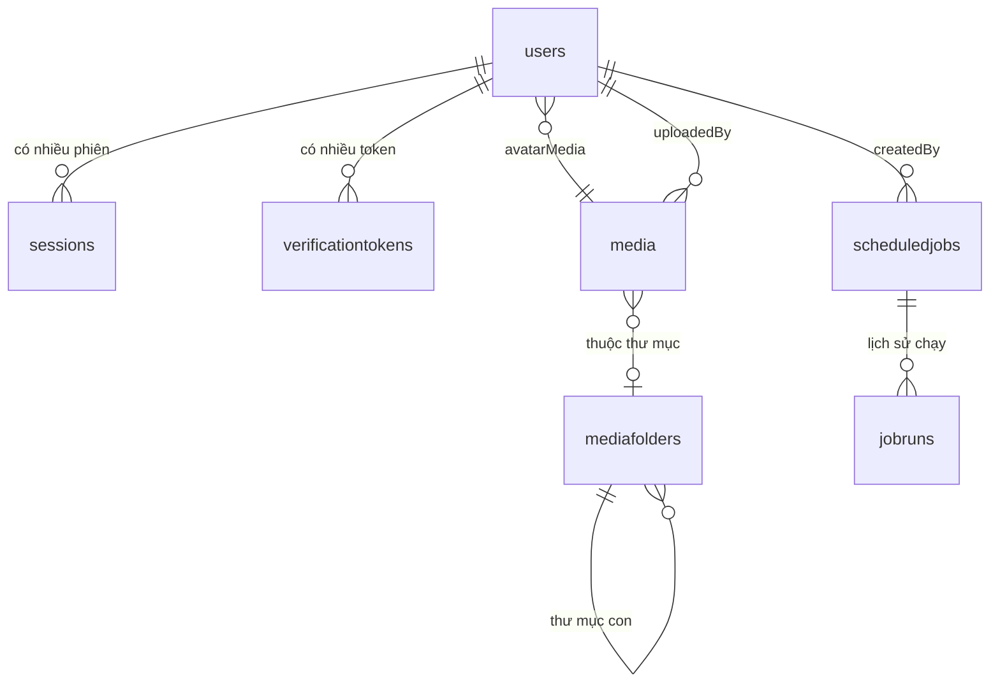

# 02 — Mô hình dữ liệu

## Quan hệ giữa các collection



MongoDB **không có khoá ngoại**. Các quan hệ trên chỉ là `ObjectId` + `ref`; toàn
vẹn tham chiếu do tầng service đảm bảo. Xem mục "Toàn vẹn tham chiếu" bên dưới.

## Embed hay reference — quyết định của từng chỗ

| Dữ liệu | Cách làm | Lý do |
|---|---|---|
| `users.identities` (tài khoản Google đã liên kết) | **Embed** | Số lượng có giới hạn (vài provider), luôn đọc cùng user, không truy vấn độc lập |
| `sessions` | **Reference** | Tăng không giới hạn theo số lần đăng nhập, cần truy vấn/xoá độc lập |
| `verificationtokens` | **Reference** | Tăng không giới hạn, có TTL riêng |
| Ảnh trong thư mục | **Reference** | Một thư mục có thể chứa hàng nghìn ảnh |
| `jobruns` | **Reference** | Lịch sử tăng liên tục, có TTL 90 ngày |

Nguyên tắc: mảng nhúng **tăng không giới hạn** là sai. Nó sẽ chạm giới hạn
16MB/document và làm mọi lần cập nhật chậm dần.

## Chi tiết từng collection

### `users`

| Field | Kiểu | Ghi chú |
|---|---|---|
| `email` | String | unique, lowercase, trim |
| `passwordHash` | String \| null | `select: false`; null với tài khoản chỉ dùng Google/magic link |
| `name` | String | required, max 120 |
| `avatarMedia` | ObjectId → Media | null = dùng chữ cái đầu |
| `role` | enum | `SUPER_ADMIN` / `ADMIN` / `USER` |
| `status` | enum | `ACTIVE` / `BLOCKED` |
| `emailVerifiedAt` | Date \| null | null = chưa xác minh |
| `identities[]` | Subdocument | `{ provider, providerUserId, email, linkedAt }` |
| `blockedAt`, `blockedBy` | | truy vết ai đã chặn |

**`passwordHash` dùng `select: false`** nên mọi query mặc định không kéo field này
về. Chỉ luồng đăng nhập chủ động `.select('+passwordHash')`.

**Không hash mật khẩu trong `pre('save')`.** Hook `save` không chạy với
`findOneAndUpdate`/`updateOne`, nên một hàm đổi mật khẩu viết bằng
`findByIdAndUpdate` sẽ lưu mật khẩu THÔ mà không báo lỗi. Dự án hash tường minh
trong service.

### `sessions`

| Field | Ghi chú |
|---|---|
| `refreshTokenHash` | SHA-256 của refresh token, unique. Không lưu token thô |
| `provider` | Cách đăng nhập phiên này, để hiển thị cho người dùng |
| `userAgent`, `ip` | Chỉ để người dùng nhận ra thiết bị. **Không dùng cho quyết định bảo mật** — client tự khai được |
| `expiresAt` | TTL index |
| `revokedAt`, `revokedReason` | null = còn hiệu lực |

Vì sao cần collection này: JWT đã phát ra thì không thu hồi được. Lưu phiên trong
DB cho phép "đăng xuất thiết bị khác" và "chặn user là cắt mọi phiên ngay".

### `verificationtokens`

Một collection cho cả ba mục đích, phân biệt bằng `type`:
`EMAIL_VERIFY` / `MAGIC_LINK` / `PASSWORD_RESET`.

Chỉ lưu `tokenHash`, không lưu token thô. `consumedAt` đánh dấu đã dùng **thay vì
xoá document** — để phân biệt được "token sai" với "token đã dùng rồi" mà báo lỗi
cho đúng.

### `media` và `mediafolders`

`media.status`: `PENDING` (đã cấp URL, chưa xác nhận) → `READY` (file có thật trên
R2). Record PENDING quá cũ chính là rác cần dọn.

`media.size` được ghi lại bằng **số thật đọc từ R2** lúc confirm, không tin số
client khai báo.

`mediafolders` dùng adjacency list (`parent`) kèm `path` lưu sẵn để hiển thị
breadcrumb và tìm cây con bằng một truy vấn prefix. **Đổi tên thư mục phải cập
nhật `path` cho cả cây con.**

Cố tình **không lưu `usageCount`** trong media: đếm sẵn rất dễ lệch, và lệch theo
hướng nguy hiểm (xoá mất ảnh đang dùng). Xem `media.usage.js`.

### `systemsettings`

Singleton: đúng một document, chốt bằng `key: 'GLOBAL'` + unique index.

**Ràng buộc quan trọng:** không được tắt cả ba phương thức đăng nhập cùng lúc, nếu
không không ai vào được hệ thống kể cả Super Admin. Service chặn trường hợp này.

### `scheduledjobs` và `jobruns`

`payload` là `Mixed` nên Mongoose không validate được → **Zod là lớp chặn duy
nhất**, dùng `discriminatedUnion` theo `type`.

`isRunning` là cờ chống chạy trùng, phải đặt/nhả bằng thao tác nguyên tử và nhả
trong `finally`. Cờ kẹt lại = job không bao giờ chạy nữa.

## Index

| Collection | Index | Mục đích |
|---|---|---|
| `users` | `email` unique | Ràng buộc nghiệp vụ |
| | `role + status` | Lọc ở khu quản trị |
| | `identities.provider + identities.providerUserId` sparse | Tìm theo tài khoản Google |
| `sessions` | `refreshTokenHash` unique | Tra cứu khi refresh |
| | `user + createdAt` | Danh sách phiên của một user |
| | `expiresAt` TTL 0 | Tự dọn phiên hết hạn |
| `verificationtokens` | `tokenHash` unique | Tra cứu khi tiêu thụ |
| | `expiresAt` TTL 86400 | Giữ thêm 1 ngày để báo lỗi "đã hết hạn" |
| `media` | `key` unique | Một object = một record |
| | `folder + createdAt` | Duyệt theo thư mục |
| | `status + createdAt` | Job dọn rác tìm record PENDING cũ |
| `mediafolders` | `parent + name` unique | Không trùng tên trong cùng thư mục |
| `scheduledjobs` | `name` unique | |
| `jobruns` | `startedAt` TTL 90 ngày | Lịch sử không phình vô hạn |

**Index được tạo bằng migration, không để Mongoose `autoIndex`.** Ở production
`autoIndex` bị tắt vì tạo index lúc khởi động làm chậm và có thể khoá collection
lớn. Khai báo trong schema chỉ để làm tài liệu tại chỗ — hai nơi phải khớp nhau.

### Bẫy TTL

MongoDB quét dọn TTL mỗi **~60 giây**, không tức thì. Document hết hạn có thể còn
tồn tại một lúc, nên code vẫn phải tự kiểm tra `expiresAt > now` — đừng tin TTL.

## Toàn vẹn tham chiếu

MongoDB không có `ON DELETE CASCADE`. Mỗi lần xoá phải tự quyết định:

| Xoá | Xử lý | Ở đâu |
|---|---|---|
| Media | **Chặn** nếu đang được dùng; `force=true` thì gỡ tham chiếu rồi xoá | `media.service.deleteMedia` + `media.usage.js` |
| Thư mục | **Chặn** nếu còn ảnh hoặc thư mục con | `mediaFolder.service.deleteFolder` |
| User | Chưa triển khai (dự án chỉ chặn, không xoá user) | — |
| ScheduledJob | Xoá kèm huỷ cron task trước | `scheduler.service.deleteJob` |

Khi thêm nghiệp vụ mới tham chiếu media, **bắt buộc** thêm entry vào
`MEDIA_CONSUMERS` trong `media.usage.js`. Quên bước này là xoá mất ảnh đang hiển thị.

## Migration

Dùng **migrate-mongo**. Mỗi thay đổi cấu trúc/index/dữ liệu là một file có `up` và
`down`, commit vào git.

```bash
npm run db:migrate        # chạy các migration chưa áp dụng
npm run db:migrate:down   # hoàn tác migration gần nhất
npm run db:seed           # tạo Super Admin đầu tiên
```

Lưu ý tên collection trong migration: Mongoose chuyển model `VerificationToken` →
collection `verificationtokens` (số nhiều, chữ thường). Viết sai tên thì index
được tạo trên một collection rỗng khác và **không có tác dụng gì** — lỗi rất khó
phát hiện.

## Transaction

Cần replica set — `docker-compose.yml` đã dựng `rs0` một node cho môi trường dev.

Dùng `withTransaction()` trong `shared/config/db.js` cho thao tác nhiều document
quan trọng. **Phải truyền `{ session }` vào MỌI thao tác bên trong** — quên là lỗi
hay gặp nhất, thao tác đó nằm ngoài transaction và không được rollback.

Chỗ nên dùng transaction trong base này: đổi tên thư mục (cập nhật path cả cây
con), gỡ nhiều tham chiếu media cùng lúc.
