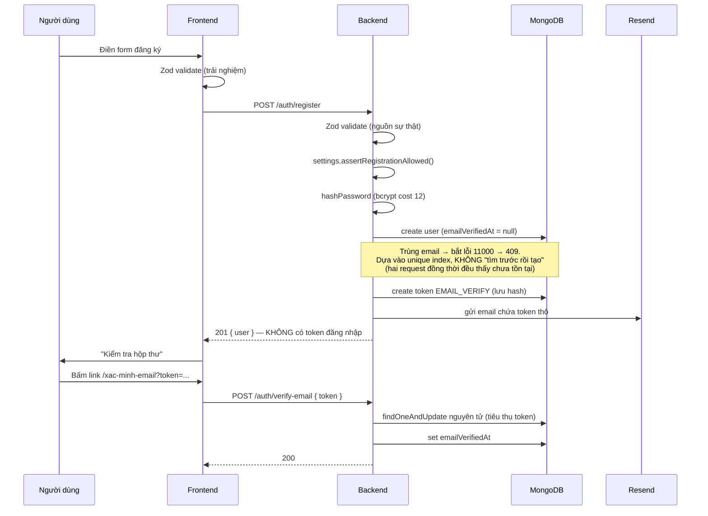
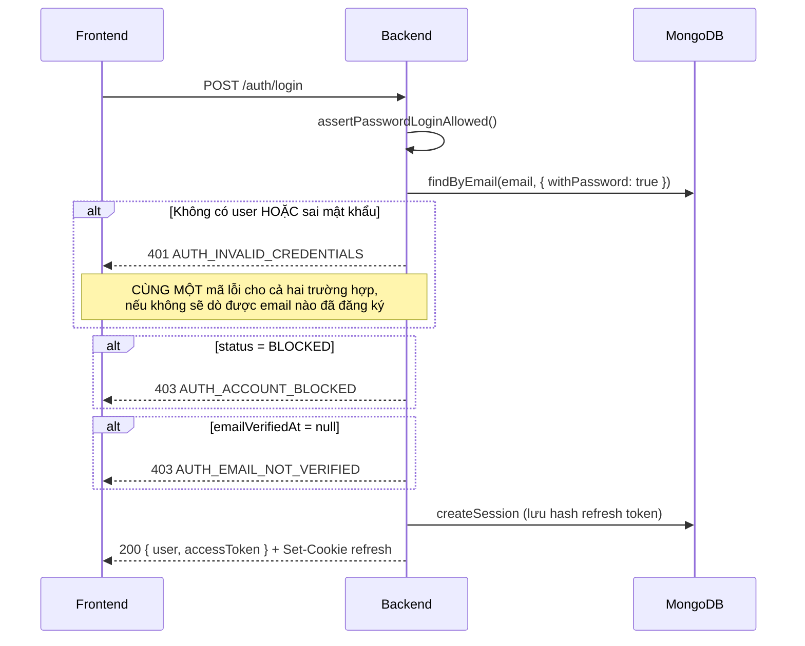
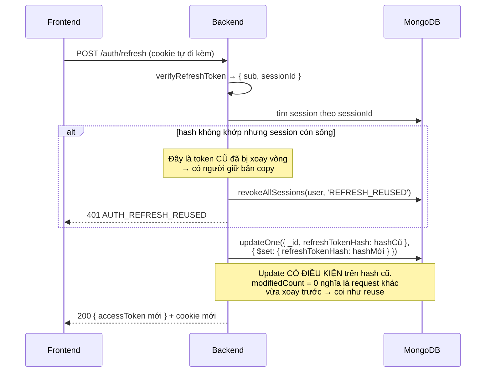
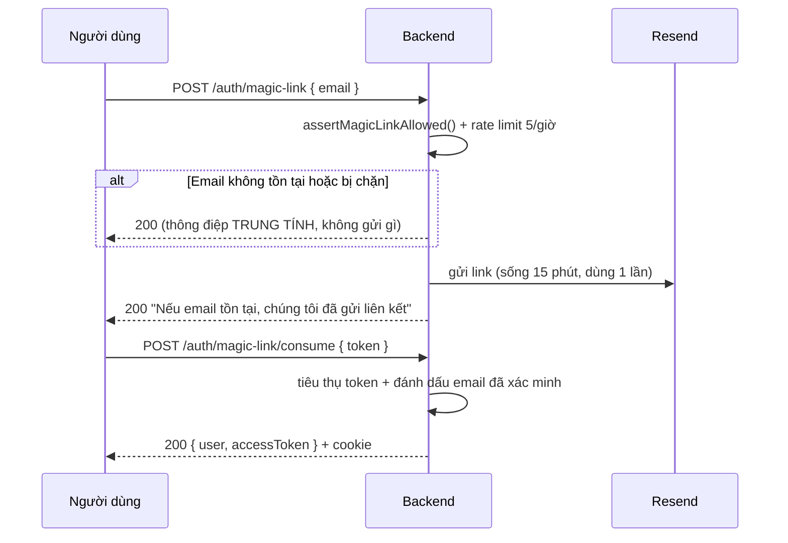
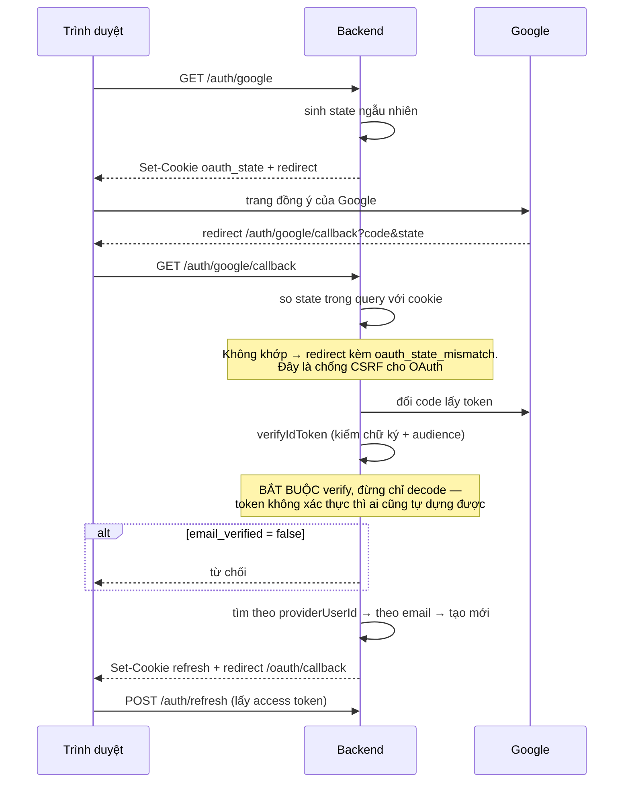
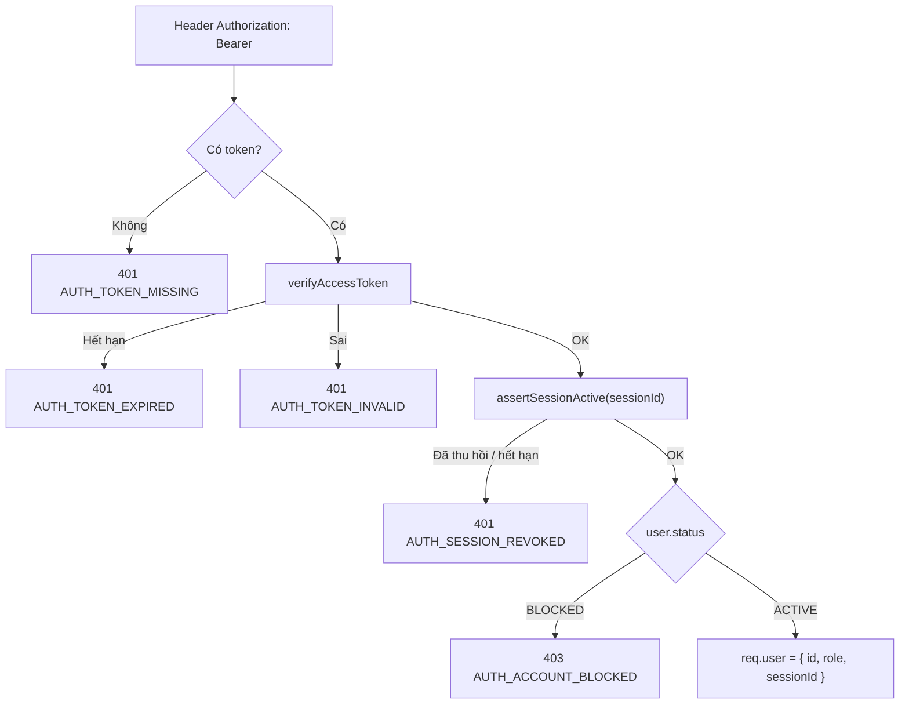

# 03 — Luồng xác thực

## Chiến lược token

| Token | Lưu ở đâu | Thời hạn | Vì sao |
|---|---|---|---|
| Access token (JWT) | **Bộ nhớ** frontend (biến trong `http.js`) | 15 phút | localStorage đọc được bằng JS → XSS lấy được token. Để trong bộ nhớ thì F5 mất, bù lại bằng `/auth/refresh` |
| Refresh token (JWT) | **Cookie httpOnly** | 30 ngày | JS không đọc được. Có xoay vòng mỗi lần dùng |
| Token dùng một lần | DB (chỉ lưu SHA-256) | 15–60 phút | Gửi qua email, dùng một lần |

Cookie refresh token: `httpOnly`, `secure` (production), `sameSite: 'lax'`,
`path: '/api/v1/auth'` — chỉ gửi kèm khi gọi nhóm route auth.

## Đăng ký + xác minh email

Hai điểm cần nhớ:

- **Đăng ký không trả token đăng nhập.** Phải xác minh email trước.
- **Tiêu thụ token phải nguyên tử.** Nếu tách thành "tìm → kiểm tra → cập nhật",
  hai request bấm link cùng lúc đều qua được và token dùng được 2 lần.

## Đăng nhập bằng mật khẩu

Thứ tự kiểm tra có chủ ý: chỉ sau khi xác thực được mật khẩu mới báo lỗi cụ thể
(bị chặn / chưa xác minh). Báo sớm hơn là tiết lộ thông tin về tài khoản.

## Refresh token rotation

Đây là phần dễ sai nhất. Mỗi lần refresh sẽ phát token mới **và** vô hiệu token cũ.

### Bẫy ở phía frontend

Ba request song song cùng nhận 401 → cả ba cùng gọi `/auth/refresh` → request thứ
2 và 3 dùng token đã bị vô hiệu → bị coi là reuse → **thu hồi hết phiên, người
dùng bị đăng xuất oan**.

Cách xử lý trong `http.js`: giữ một `refreshPromise` dùng chung. Request đầu tiên
gọi refresh, các request sau xếp hàng chờ đúng promise đó.

## Magic link

Bấm được link trong email cũng chứng minh sở hữu email → nếu `emailVerifiedAt` còn
null thì đánh dấu đã xác minh luôn.

**Quyết định mặc định của base:** magic link KHÔNG tự tạo tài khoản mới (chỉ gửi
cho email đã đăng ký), vì tự tạo sẽ bỏ qua bước nhập tên và đồng ý điều khoản. Dù
chọn hướng nào, response phải **giống nhau** cho cả hai trường hợp.

## Google OAuth

Hai điểm bảo mật cốt tử:

1. **`state`** chống CSRF. Cookie phải `sameSite: 'lax'` (không phải `strict`),
   nếu không cookie không được gửi kèm khi Google redirect về.
2. **`email_verified`** phải được kiểm tra. Nếu bỏ qua, kẻ tấn công tạo tài khoản
   Google với email của người khác rồi được tự động liên kết vào tài khoản đó —
   đây là lỗ hổng chiếm tài khoản.

**Access token không truyền qua URL.** URL nằm trong history trình duyệt, bị gửi
trong header `Referer`, và hay bị copy-paste. Frontend tới trang callback rồi gọi
`/auth/refresh` bằng cookie vừa được set.

## Quên / đặt lại / đổi mật khẩu

| Luồng | Điểm quan trọng |
|---|---|
| Quên mật khẩu | Email không tồn tại → vẫn trả thành công, không gửi gì. Báo "email không tồn tại" là biến trang này thành công cụ dò danh sách email |
| Đặt lại mật khẩu | **Thu hồi TOÀN BỘ phiên** sau khi đổi. Người dùng đặt lại thường vì nghi bị chiếm tài khoản — không cắt phiên thì kẻ kia vẫn đang đăng nhập |
| Đổi mật khẩu (đang đăng nhập) | Thu hồi mọi phiên **trừ phiên hiện tại**, để người dùng không bị đăng xuất ngay sau khi đổi |

Cả ba đều gửi email thông báo sau khi đổi thành công — đó là tín hiệu duy nhất chủ
tài khoản nhận được nếu không phải họ làm.

## Xác thực mỗi request

Bước `assertSessionActive` là **lý do tồn tại** của collection `sessions`: access
token là JWT stateless, nếu không kiểm tra lại session ở đây thì việc thu hồi phiên
hoàn toàn vô nghĩa cho tới khi token hết hạn.

Đánh đổi: thêm một truy vấn DB mỗi request. Chấp nhận được, và có thể cache về sau.

## Rate limit

| Route | Giới hạn | Lý do |
|---|---|---|
| `/auth/login`, `/auth/register`, `/auth/reset-password` | 10 / 15 phút | Brute-force mật khẩu |
| `/auth/magic-link`, `/auth/forgot-password`, `/auth/resend-verification` | 5 / giờ | Spam hộp thư người khác, cạn hạn mức Resend |
| Toàn bộ `/api` | 1000 / 15 phút | Lưới an toàn thô |

Các route gửi email nên tính giới hạn theo **email trong body**, không chỉ theo IP —
kẻ tấn công đổi IP vẫn không spam được một địa chỉ cụ thể.

Deploy sau reverse proxy phải bật `app.set('trust proxy', 1)`, nếu không mọi request
trông như đến từ cùng một IP và cả hệ thống bị chặn chung.
