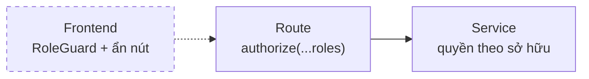
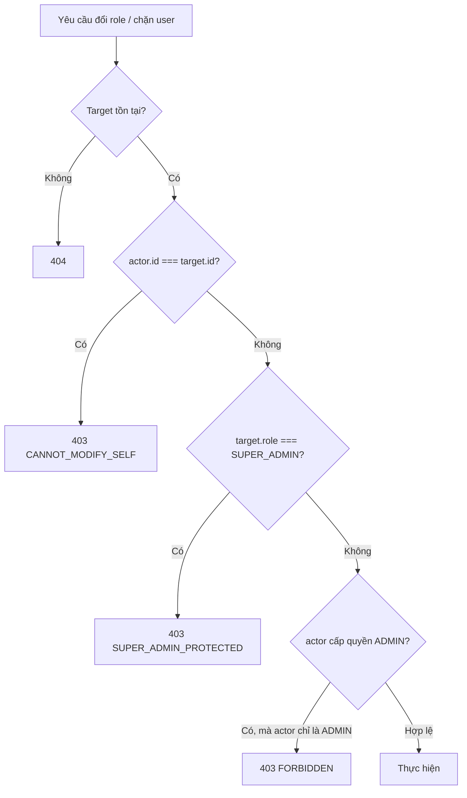
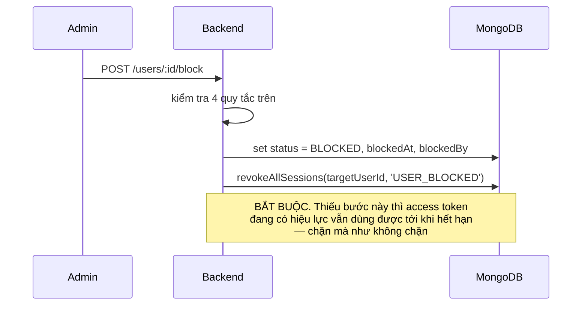

# 04 — Phân quyền và bảo vệ Super Admin

## Ba mức role

| Role | Phạm vi |
|---|---|
| `USER` | Dữ liệu của chính mình: hồ sơ, mật khẩu, phiên đăng nhập, ảnh đại diện |
| `ADMIN` | Thêm: danh sách người dùng, chặn/mở chặn, đổi role trong nhóm USER, thư viện media |
| `SUPER_ADMIN` | Thêm: cấu hình hệ thống, lịch tự động, cấp quyền ADMIN |

## Quyền được kiểm ở đâu

| Loại quyền | Kiểm ở đâu | Vì sao |
|---|---|---|
| Theo role | `authorize()` ở tầng route | Đọc file routes là thấy ngay ai gọi được endpoint nào |
| Theo sở hữu tài nguyên | Tầng service | Chỉ service mới biết ai là chủ của record |
| Ở frontend | `RoleGuard` + ẩn nút | **Chỉ để trải nghiệm**, không phải bảo mật |

**Frontend không bao giờ là lớp bảo vệ.** `RoleGuard` chỉ giúp người dùng không
thấy trang họ không dùng được. Ai cũng mở DevTools gọi API trực tiếp được — backend
là nơi duy nhất quyết định.

Không kiểm role bằng `if` rải rác trong controller/service. Sót một chỗ là lộ dữ liệu.

## Bảo vệ Super Admin

Bốn quy tắc, kiểm theo đúng thứ tự này trong `users.service`:

| Quy tắc | Mã lỗi | Vì sao |
|---|---|---|
| Không tự chặn / tự hạ quyền chính mình | `CANNOT_MODIFY_SELF` | Admin tự hạ quyền sẽ tự khoá mình khỏi khu quản trị |
| Không ai hạ quyền / chặn Super Admin | `SUPER_ADMIN_PROTECTED` | Kể cả Super Admin khác. Đây là chốt cuối của hệ thống |
| Chỉ Super Admin cấp được quyền ADMIN | `FORBIDDEN` | Admin tự nhân bản admin sẽ mất kiểm soát |
| Zod chỉ nhận role trong `ASSIGNABLE_ROLES` | `VALIDATION_ERROR` | Request gửi `role: 'SUPER_ADMIN'` bị chặn ngay ở tầng validate |

`ASSIGNABLE_ROLES = [ADMIN, USER]` — không có `SUPER_ADMIN`. Nghĩa là **không có
endpoint nào tạo được Super Admin**. Tài khoản đầu tiên tạo bằng `npm run db:seed`
chạy trực tiếp trên server.

Muốn thêm Super Admin thứ hai: hiện tại phải dùng script. Đó là lựa chọn có chủ ý —
quyền cao nhất không nên cấp được qua giao diện web.

## Chặn tài khoản phải cắt phiên

Middleware `authenticate` cũng kiểm `status` mỗi request, nên đây là hai lớp cùng
bảo vệ một việc.

## Chống IDOR

IDOR = user A đổi id trên URL thành id của user B và sửa được dữ liệu người khác.

| Nơi | Cách chặn |
|---|---|
| `DELETE /sessions/:id` | Update **có điều kiện** cả `user: userId`: `updateOne({ _id: sessionId, user: userId, revokedAt: null }, ...)`. Không có điều kiện `user` là đăng xuất được người khác |
| `POST /media/:id/confirm` | Service kiểm `record.uploadedBy === userId` hoặc là admin |
| Đặt ảnh đại diện | `assertUsableAsAvatar` kiểm media thuộc về user đó hoặc là ảnh thư viện dùng chung |
| Route dạng `/users/:id/...` | `authorizeOwnerOrAdmin(getOwnerId)` ở tầng route |

Mẹo chung: **đưa điều kiện sở hữu vào chính câu truy vấn**, đừng "đọc rồi so sánh
rồi ghi". Vừa gọn hơn vừa không có khe hở giữa lúc đọc và lúc ghi.

## Không để hệ thống tự khoá cửa

Hai chỗ có nguy cơ khiến không ai vào được hệ thống:

1. **Tắt cả ba phương thức đăng nhập** trong cấu hình hệ thống.
   `settings.service.updateSettings` chặn: phải giữ ít nhất một.
2. **Không còn Super Admin nào ACTIVE.** Có `countActiveSuperAdmins()` để kiểm tra
   trước các thao tác nguy hiểm.

Giao diện cũng nên chặn sớm (khoá công tắc cuối cùng, ẩn nút với Super Admin) để
người dùng không phải bấm rồi mới nhận lỗi.

## Bảng phân quyền endpoint

| Endpoint | USER | ADMIN | SUPER_ADMIN |
|---|---|---|---|
| `GET /users/me`, `PATCH /users/me` | ✓ | ✓ | ✓ |
| `GET /sessions`, `DELETE /sessions/:id` | ✓ (của mình) | ✓ | ✓ |
| `POST /media/upload-url`, `/:id/confirm` | ✓ | ✓ | ✓ |
| `GET /settings/public` | ✓ (cả khách) | ✓ | ✓ |
| `GET /users`, `/:id` | ✗ | ✓ | ✓ |
| `PATCH /users/:id/role` | ✗ | ✓ (chỉ USER) | ✓ |
| `POST /users/:id/block`, `/unblock` | ✗ | ✓ | ✓ |
| `GET /media`, `PATCH`, `DELETE`, thư mục | ✗ | ✓ | ✓ |
| `GET /settings`, `PATCH /settings` | ✗ | ✗ | ✓ |
| `/scheduler/*` | ✗ | ✗ | ✓ |

`/scheduler/*` siết chặt hơn cả khu admin thường vì job có thể xoá file hàng loạt
và gửi email tới toàn bộ người dùng.
