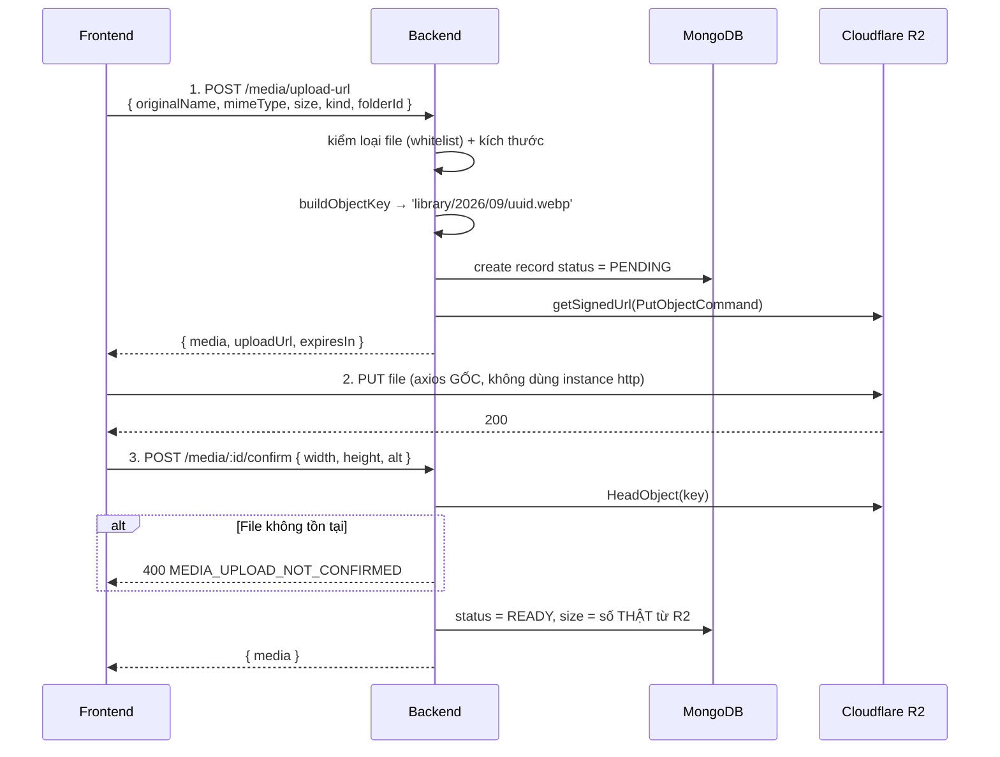
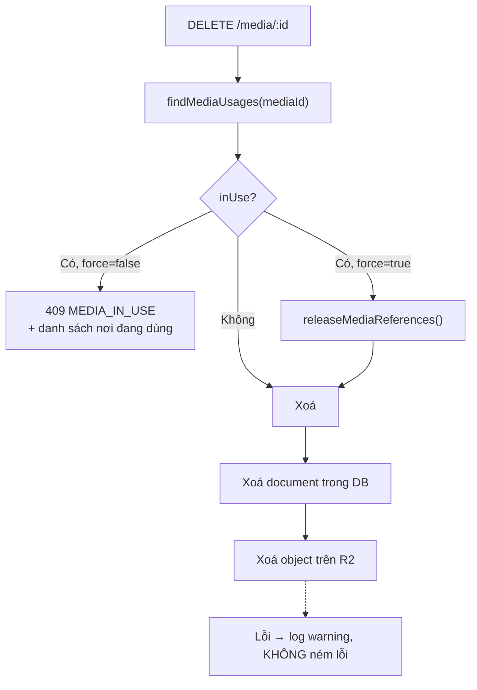

# 05 — Media và Storage (Cloudflare R2)

## Luồng upload 3 bước



### Vì sao chia 3 bước

File đi trực tiếp từ trình duyệt lên R2, không qua backend. Backend nhẹ hơn, không
bị giới hạn body size, không tốn băng thông. Đổi lại: **bước 1 là chốt kiểm soát
duy nhất** — sau khi cấp URL, backend không chặn được gì nữa.

### Ba bẫy thường gặp

**1. Dùng instance `http` để PUT lên R2.** Sai vì ba lý do: `baseURL` trỏ tới API
của mình; interceptor gắn header `Authorization` mà R2 sẽ từ chối (header đó không
nằm trong chữ ký); `withCredentials: true` gửi cookie sang domain lạ. Phải dùng
`axios` gốc.

**2. Không truyền đúng `Content-Type` khi PUT.** R2 trả `403 SignatureDoesNotMatch`.
`mimeType` đã được ký vào URL ở bước 1 nên phải khớp chính xác.

**3. Quên bước 3.** Record mắc kẹt ở `PENDING`, ảnh không hiện được, và job dọn rác
sẽ xoá nó. Đây là lý do cả ba bước được gói trong một hook `useMediaUpload`.

### Ràng buộc được ký vào presigned URL

```
ContentType   → client không đổi được loại file sau khi nhận URL
ContentLength → R2 từ chối file lớn hơn số đã khai báo
expiresIn     → URL hết hiệu lực sau R2_PRESIGN_TTL_SECONDS (300s)
```

`size` client khai báo dùng để ký, nhưng size lưu vào DB là **số thật đọc từ R2**
lúc confirm.

## Object key

```
library/2026/09/<uuid>.webp
avatars/2026/09/<uuid>.jpg
```

Không dùng tên gốc làm key: tên gốc có thể trùng, chứa ký tự lạ, hoặc chứa `../`
(path traversal). Chèn năm/tháng để một "thư mục" trên R2 không chứa quá nhiều object.

## Chặn xoá ảnh đang dùng

Đây là trọng tâm của Phase 12. MongoDB không có khoá ngoại nên không có gì tự chặn.



### Registry consumer

`media.usage.js` giữ danh sách nơi có thể tham chiếu media:

```js
const MEDIA_CONSUMERS = [
  {
    label: 'Ảnh đại diện người dùng',
    count: (mediaId) => usersService.countUsersUsingAvatar(mediaId),
    release: (mediaId) => usersService.clearAvatarByMediaId(mediaId),
  },
];
```

> **Khi thêm nghiệp vụ mới tham chiếu media** (bài viết có ảnh bìa, sản phẩm có
> ảnh...), **bắt buộc** thêm một entry vào đây. Quên bước này là xoá mất ảnh đang
> hiển thị trên trang.

Cố tình **không lưu `usageCount`** trong document media. Đếm sẵn thì nhanh nhưng
rất dễ lệch — quên tăng/giảm ở một luồng là sai vĩnh viễn, và sai theo hướng nguy
hiểm nhất: cho xoá ảnh đang dùng.

### Thứ tự xoá: DB trước, R2 sau

| Thứ tự | Nếu bước hai lỗi | Hậu quả |
|---|---|---|
| **DB → R2** (dùng cách này) | File rác còn trên R2 | Job dọn ảnh mồ côi sẽ xử lý. Người dùng không thấy gì bất thường |
| R2 → DB | Record trỏ tới file không tồn tại | Ảnh vỡ trên giao diện |

Nguyên tắc: khi buộc phải chọn, **hỏng theo hướng ít gây hại hơn**.

### Cho phép `force` thay vì chặn cứng

Admin cần xoá được ảnh vi phạm hoặc sai nội dung ngay, kể cả khi đang dùng. Chặn
hẳn sẽ buộc họ đi sửa từng chỗ tham chiếu trước — bất tiện, và cuối cùng họ sẽ vào
DB sửa tay (tệ hơn nhiều).

Giao diện `DeleteMediaDialog` vì vậy liệt kê rõ nơi đang dùng và nói hậu quả cụ
thể trước khi cho bấm force.

## Ảnh mồ côi

Hai loại rác khác nhau:

| Loại | Điều kiện | Vì sao tồn tại |
|---|---|---|
| Record `PENDING` cũ | `status = PENDING`, cũ hơn 24h | Người dùng xin URL rồi bỏ dở (mất mạng, đóng tab) |
| Media mồ côi | `status = READY`, không ai tham chiếu, cũ hơn `ORPHAN_MEDIA_GRACE_HOURS` | Đã xoá bài viết dùng ảnh, hoặc upload rồi không dùng |

### Vì sao cần khoảng chờ (grace period)

Ảnh vừa upload xong nhưng người dùng chưa bấm Lưu thì **chưa ai tham chiếu**. Dọn
ngay là xoá mất ảnh họ đang soạn. Mặc định chờ 24 giờ.

### Luôn chạy `dryRun` trước

Job `CLEANUP_ORPHAN_MEDIA` có `payload.dryRun`, mặc định **bật** khi tạo mới. Chạy
thử để xem danh sách sẽ bị xoá, xác nhận đúng rồi mới tắt dryRun. Job này xoá file
vĩnh viễn, không hoàn tác được.

## Thư mục

Adjacency list (`parent`) kèm `path` lưu sẵn:

```
mediafolders: { name: '2026', parent: <id của 'san-pham'>, path: '/san-pham/2026' }
```

`path` để hiển thị breadcrumb và tìm cây con bằng một truy vấn prefix thay vì lần
từng cấp.

**Đổi tên thư mục phải cập nhật `path` cho cả cây con** (path của con chứa path của
cha). Bỏ bước này thì breadcrumb và lọc theo prefix sai. Nên bọc trong transaction.

**Xoá thư mục bị chặn nếu chưa rỗng** (`FOLDER_NOT_EMPTY`). Cố tình không xoá đệ
quy: xoá cả cây bằng một cú bấm là hành động phá huỷ quá dễ xảy ra do nhầm.

Unique index `{ parent, name }` không cho hai thư mục trùng tên trong cùng cha.

## Ảnh đại diện (Phase 11)

Dùng chung hệ thống media với `kind: 'AVATAR'`.

`assertUsableAsAvatar` kiểm ba điều: media tồn tại, `status = READY`, và thuộc về
user đó **hoặc** là ảnh thư viện dùng chung. Không kiểm thì user A đặt ảnh riêng của
user B làm avatar của mình.

Ảnh đại diện lưu **ngay khi upload xong**, không chờ bấm "Lưu thay đổi" — upload đã
là hành động rõ ràng của người dùng.

## Biến môi trường

| Biến | Ghi chú |
|---|---|
| `R2_ACCOUNT_ID` | Dùng để dựng endpoint `https://<id>.r2.cloudflarestorage.com` |
| `R2_ACCESS_KEY_ID`, `R2_SECRET_ACCESS_KEY` | Secret, không commit |
| `R2_BUCKET` | Tên bucket |
| `R2_PUBLIC_BASE_URL` | Domain public để đọc ảnh, ví dụ `https://cdn.example.com` |
| `R2_PRESIGN_TTL_SECONDS` | 300 — URL upload sống 5 phút |
| `UPLOAD_MAX_SIZE_MB` | 5 |

R2 dùng `region: 'auto'` (bắt buộc, không phải tên vùng thật).

Bucket nên bật CORS cho phép `PUT` từ domain frontend, nếu không trình duyệt chặn
bước 2. Đây là cấu hình phía Cloudflare, không nằm trong code.
