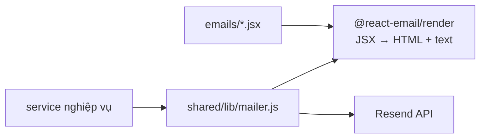
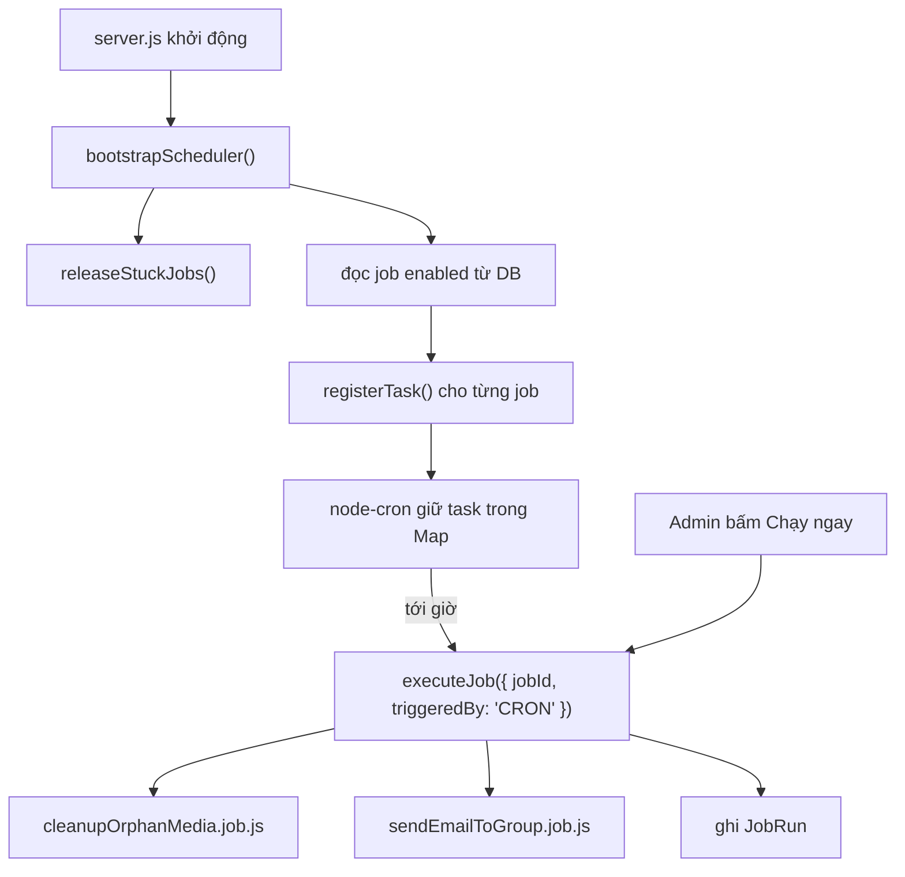

# 06 — Email và Lịch tự động

## Email: Resend + React Email



Service nghiệp vụ **không biết** đang dùng Resend hay Nodemailer — nó chỉ gọi
`sendEmail({ to, subject, template })`. Đổi nhà cung cấp chỉ sửa `mailer.js`.

### Danh sách template

| File | Khi nào gửi | Phase |
|---|---|---|
| `VerifyEmail.jsx` | Sau khi đăng ký | 2 |
| `MagicLinkEmail.jsx` | Xin link đăng nhập | 4 |
| `ResetPasswordEmail.jsx` | Quên mật khẩu | 2 |
| `PasswordChangedEmail.jsx` | Sau khi đổi/đặt lại mật khẩu | 6 |
| `WelcomeEmail.jsx` | Sau khi xác minh email | 6 |
| `AnnouncementEmail.jsx` | Job gửi theo lịch | 13 |
| `DigestEmail.jsx` | Job gửi theo lịch (bản tin có danh sách) | 13 |

Xem trước không cần gửi thật: `npm run email:dev` → `http://localhost:3030`.
Mỗi template export `PreviewProps` để trình xem trước có dữ liệu mẫu.

### Quy tắc viết email

Email client (đặc biệt Outlook) hỗ trợ CSS rất hạn chế:

- Style **inline**, không dùng class hay file CSS ngoài.
- **Không** Flexbox, không Grid — Outlook không hiểu.
- Mọi link phải là **URL tuyệt đối** (email không có "trang hiện tại").
- Luôn có `<Preview>` — dòng chữ xám cạnh tiêu đề trong hộp thư.
- Luôn gửi kèm bản **text** (`render(template, { plainText: true })`) để giảm khả
  năng bị đánh dấu spam.
- Nút bấm phải kèm **link dạng chữ** bên dưới: một số email client chặn nút.

### Hai điểm dễ sai

**Resend không throw khi lỗi** — nó trả `{ data, error }`. Phải tự kiểm `error`,
nếu không lỗi gửi mail bị nuốt im lặng.

**Không dùng `dangerouslySetInnerHTML`** cho nội dung admin nhập (`AnnouncementEmail.body`).
Tách theo `\n\n` rồi render từng đoạn bằng `<Text>`.

### Gửi mail lỗi không được làm đổ nghiệp vụ

Ví dụ ở `register()`: user đã được tạo trong DB rồi. Nếu gửi mail lỗi mà ném
exception thì client nhận 500 và tưởng đăng ký thất bại, trong khi tài khoản đã
tồn tại — lần sau đăng ký lại sẽ nhận lỗi "email đã tồn tại".

Cách đúng: log lỗi, vẫn trả thành công, kèm nút "gửi lại email".

## Scheduler (Phase 13)

### Kiến trúc



Tách bạch hai việc:

- `shared/lib/scheduler.js` — **cơ chế hẹn giờ** (đăng ký, huỷ, liệt kê task).
- `modules/scheduler/jobs/*.job.js` — **nội dung công việc**, là hàm thuần nhận
  payload. Nhờ vậy test được bằng cách gọi trực tiếp, không phải chờ tới giờ.

`syncJobTask` truyền `jobId` vào handler chứ không truyền cả object job — handler sẽ
đọc lại cấu hình **mới nhất** từ DB mỗi lần chạy, không dùng bản chụp từ lúc đăng ký.

### Chống chạy trùng

Job chạy lâu hơn chu kỳ cron thì lượt sau phải bị bỏ qua. Dùng khoá **nguyên tử**:

```js
const job = await ScheduledJobModel.findOneAndUpdate(
  { _id: jobId, isRunning: false },
  { $set: { isRunning: true, runningSince: new Date() } },
  { new: true },
);
if (!job) throw conflict('Job đang chạy', JOB_ALREADY_RUNNING);
```

Phải là **một lệnh**. Nếu tách "đọc → kiểm tra → ghi" thì hai lượt cùng vào được.

**Nhả cờ trong `finally`.** Thiếu là job kẹt cờ vĩnh viễn và không bao giờ chạy lại.
`releaseStuckJobs()` lúc khởi động dọn cờ còn sót từ lần process bị kill.

### Lỗi trong job không được làm sập process

`node-cron` không có cơ chế báo lỗi. Handler reject mà không ai bắt sẽ thành
`unhandledRejection` và có thể làm sập server. Vì vậy `registerTask` bọc handler
trong try/catch, và `executeJob` ghi lỗi vào `JobRun` thay vì ném ra ngoài (trừ khi
chạy thủ công — lúc đó admin cần thấy lỗi ngay trên giao diện).

### Hai loại job có sẵn

#### `CLEANUP_ORPHAN_MEDIA`

```jsonc
{
  "batchLimit": 500,    // số ảnh xử lý mỗi lượt
  "graceHours": 24,     // ảnh mới hơn mốc này thì bỏ qua
  "dryRun": true        // chỉ báo cáo, không xoá
}
```

`dryRun` **bật sẵn khi tạo mới**. Job này xoá file vĩnh viễn — chạy thử, xem kết quả,
xác nhận đúng rồi mới tắt.

Thống kê ghi vào `JobRun.stats`: `{ pendingDeleted, orphanDeleted, r2Deleted, freedBytes, dryRun }`.

#### `SEND_EMAIL_TO_GROUP`

```jsonc
{
  "template": "Announcement",   // Announcement | Digest
  "subject": "...",
  "heading": "...",
  "body": "...",
  "ctaLabel": "...",
  "ctaUrl": "...",
  "audience": { "role": "USER", "emailVerifiedOnly": true }
}
```

`findRecipients()` tự loại tài khoản đã bị chặn. Một email lỗi không được làm dừng
cả lô — gom lỗi vào `errors` và tiếp tục.

`template` được map **tường minh** (`{ Announcement: ..., Digest: ... }`), không
import động theo chuỗi lấy từ DB. Dữ liệu trong DB không nên quyết định file nào
được nạp.

### Giới hạn đã biết — và khi nào phải đổi

| Giới hạn | Hệ quả | Khi nào cần đổi |
|---|---|---|
| Job chạy in-process | Nhiều instance → job chạy trùng | Ngay khi scale ngang |
| Không bù lượt đã bỏ | Server tắt lúc tới giờ thì lượt đó mất | Khi job quan trọng không được bỏ |
| Payload gửi email nạp hết người nhận vào RAM | Chậm/tràn với hàng trăm nghìn user | Khi danh sách lớn — chuyển sang cursor |
| Chạy thủ công chờ kết quả trong request | Timeout với job dài | Trả `202 Accepted` + poll lịch sử |

Hướng nâng cấp khi cần: BullMQ + Redis (repeatable job, retry, job lưu bền, dùng
được nhiều instance), hoặc khoá phân tán trong MongoDB nếu muốn giữ in-process.

### Biến môi trường

| Biến | Ghi chú |
|---|---|
| `SCHEDULER_ENABLED` | **Phải `false` ở môi trường test**, nếu không job chạy thật giữa lúc test |
| `SCHEDULER_TIMEZONE` | `Asia/Ho_Chi_Minh` — cron tính giờ theo múi này |
| `ORPHAN_MEDIA_GRACE_HOURS` | Mặc định của job dọn ảnh nếu payload không truyền |

Múi giờ là chi tiết dễ bỏ qua: không đặt `timezone` thì node-cron dùng giờ hệ thống
của server, và job "3h sáng" sẽ chạy lúc 10h sáng nếu server ở UTC.
