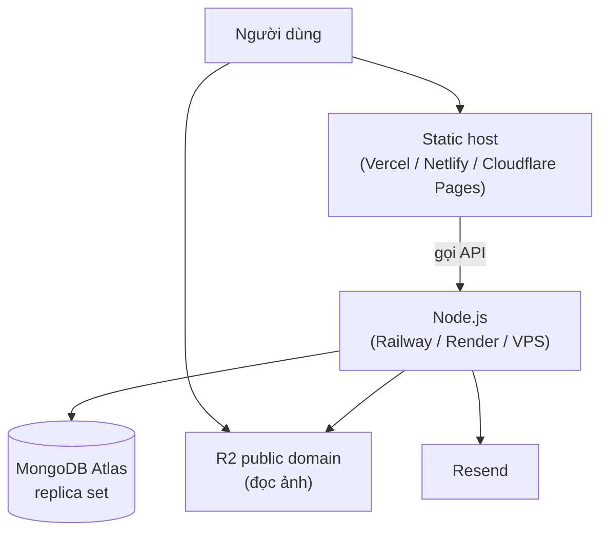

# 09 — Vận hành và deploy

> Tài liệu này viết cho người **triển khai và vận hành** hệ thống, không phải cho
> người viết code. Giả định bạn đã có source chạy được ở local.

## Kiến trúc triển khai



Frontend là file tĩnh sau khi build — không cần Node ở production. Backend cần
Node.js chạy liên tục (vì có scheduler in-process).

## Biến môi trường production

### Backend

| Biến | Giá trị production | Lưu ý |
|---|---|---|
| `NODE_ENV` | `production` | Bật `secure` cookie, tắt stack trace, tắt `autoIndex` |
| `PORT` | Do nền tảng cấp | Railway/Render tự set |
| `WEB_ORIGIN` | `https://app.example.com` | **Phải đúng chính xác** — dùng cho CORS whitelist |
| `MONGODB_URI` | `mongodb+srv://...` | Atlas đã là replica set, không cần thêm tham số |
| `JWT_ACCESS_SECRET` | `openssl rand -base64 48` | **Khác** secret dev |
| `JWT_REFRESH_SECRET` | `openssl rand -base64 48` | **Khác** access secret |
| `GOOGLE_REDIRECT_URI` | `https://api.example.com/api/v1/auth/google/callback` | Phải khớp Google Console |
| `R2_PUBLIC_BASE_URL` | Domain public của bucket | |
| `SCHEDULER_ENABLED` | `true` — **chỉ trên MỘT instance** | Xem mục Scheduler bên dưới |
| `SCHEDULER_TIMEZONE` | `Asia/Ho_Chi_Minh` | Không đặt thì job chạy theo giờ UTC |

Không đặt `SEED_SUPER_ADMIN_*` làm biến môi trường thường trực — chỉ đặt tạm khi
chạy seed rồi xoá.

### Frontend

```bash
VITE_API_URL=https://api.example.com/api/v1
VITE_APP_NAME=Tên ứng dụng
```

> **Mọi biến `VITE_*` đều lộ** trong JavaScript tải về máy người dùng. Không bao
> giờ đặt secret ở đây.

## Các bước deploy lần đầu

```bash
# 1. Database
#    Tạo cluster MongoDB Atlas, whitelist IP của server backend.

# 2. Migration — chạy TRƯỚC khi khởi động app
MONGODB_URI="mongodb+srv://..." npm run db:migrate

# 3. Seed Super Admin đầu tiên (chạy MỘT lần)
SEED_SUPER_ADMIN_EMAIL=... SEED_SUPER_ADMIN_PASSWORD=... npm run db:seed

# 4. Backend
npm ci --omit=dev   # lưu ý: tsx là dependency, không phải devDependency
npm run start -w backend

# 5. Frontend
npm run build -w frontend    # kết quả trong frontend/dist
```

### Về việc dùng `tsx` ở production

Backend chạy bằng `tsx src/server.js` thay vì `node src/server.js`. Lý do: template
email là `.jsx` và Node không tự transform JSX.

Đây là **đánh đổi có ý thức** cho dự án học tập: đơn giản, không cần bước build.
Nhược điểm là thêm một lớp transform lúc chạy (tốn thêm chút RAM và thời gian khởi
động).

Muốn bỏ `tsx` ở production: thêm bước build bằng esbuild để biên dịch `emails/*.jsx`
thành `.js`, rồi chạy bằng `node`. Xem `CHECKLIST.md` mục `[OPS-02]`.

## Scheduler khi có nhiều instance

**Đây là điểm quan trọng nhất của tài liệu này.**

Job chạy in-process. Nếu bạn deploy 3 instance backend thì mỗi instance sẽ tự hẹn
giờ và **job chạy 3 lần** — nghĩa là email gửi 3 lần cho mỗi người, và job dọn ảnh
tranh nhau xoá.

Ba cách xử lý, theo thứ tự đơn giản dần từ dưới lên:

| Cách | Làm gì | Phù hợp khi |
|---|---|---|
| **Một instance** | Chỉ chạy 1 instance backend | Tải nhỏ — đơn giản nhất |
| **Tách worker** | Deploy 2 service từ cùng source: API (`SCHEDULER_ENABLED=false`, scale tuỳ ý) và worker (`SCHEDULER_ENABLED=true`, đúng 1 instance) | Cần scale API — **khuyến nghị** |
| **Chuyển sang queue** | BullMQ + Redis | Job quan trọng, cần retry và lưu bền |

Cách thứ hai không cần sửa code, chỉ cần cấu hình biến môi trường khác nhau cho hai
service.

## CORS và cookie

Cookie refresh token đi kèm request nên cấu hình phải khớp chính xác:

| Cấu hình | Giá trị | Nếu sai thì |
|---|---|---|
| `WEB_ORIGIN` | Đúng origin của frontend, có `https://`, không có `/` cuối | Trình duyệt chặn mọi request |
| `credentials: true` (backend) | Đã có trong `cors.js` | Cookie không được gửi |
| `withCredentials: true` (frontend) | Đã có trong `http.js` | Cookie không được gửi |
| `secure` cookie | Tự `true` khi `NODE_ENV=production` | Cookie bị chặn trên HTTPS nếu `false` |
| `sameSite` | `lax` | `strict` sẽ làm luồng Google OAuth hỏng |

**Frontend và backend khác domain** (ví dụ `app.example.com` và `api.example.com`)
vẫn hoạt động với `sameSite: 'lax'` vì đây là subdomain. Nếu hai domain hoàn toàn
khác nhau thì phải dùng `sameSite: 'none'` + `secure: true`.

## Reverse proxy

Nếu backend nằm sau nginx, Railway, Render, Cloudflare:

```js
app.set('trust proxy', 1);   // trong createApp()
```

Không bật thì `req.ip` luôn là IP của proxy → rate limit tính chung cho tất cả người
dùng và **cả hệ thống bị chặn cùng lúc**.

## Cấu hình Cloudflare R2

1. Tạo bucket.
2. **Bật CORS** cho phép `PUT` từ domain frontend — nếu không bước upload bị chặn:

```json
[
  {
    "AllowedOrigins": ["https://app.example.com"],
    "AllowedMethods": ["PUT", "GET", "HEAD"],
    "AllowedHeaders": ["Content-Type"],
    "MaxAgeSeconds": 3600
  }
]
```

3. Nối custom domain (hoặc bật public access) để lấy `R2_PUBLIC_BASE_URL`.
4. Tạo API token với quyền đọc/ghi trên bucket đó.

## Google OAuth

Trong Google Cloud Console → Credentials → OAuth 2.0 Client:

- **Authorized redirect URIs** phải khớp `GOOGLE_REDIRECT_URI` **chính xác từng ký
  tự**. Sai một dấu `/` là `redirect_uri_mismatch`.
- Thêm cả URI của dev (`http://localhost:5000/...`) và production.
- App ở chế độ "Testing" chỉ cho phép các email đã thêm vào danh sách test. Muốn mở
  cho mọi người thì phải submit verification.

## Giám sát

| Việc | Cách |
|---|---|
| Health check | `GET /api/v1/health` — trả 503 khi DB mất kết nối |
| Log | Backend log JSON ở production; đẩy vào dịch vụ log của nền tảng |
| Lỗi runtime | Nên tích hợp Sentry (chưa có trong base — xem `CHECKLIST.md`) |
| Job lỗi | Bảng lịch sử chạy trong khu quản trị; nên thêm cảnh báo khi `lastStatus = FAILED` |

Uptime monitor nên trỏ vào `/health`, không trỏ vào `/` (frontend là host riêng).

## Backup

MongoDB Atlas có backup tự động ở gói trả phí. Với cluster miễn phí phải tự làm:

```bash
# Sao lưu
mongodump --uri="mongodb+srv://..." --out=./backup-$(date +%F)

# Khôi phục
mongorestore --uri="mongodb+srv://..." ./backup-2026-09-28
```

**Lưu ý về R2:** ảnh trên R2 **không** nằm trong backup MongoDB. Khôi phục DB từ bản
cũ mà job dọn ảnh đã chạy trong khoảng thời gian đó thì các record được khôi phục sẽ
trỏ tới file đã bị xoá.

Nếu điều này quan trọng: bật versioning trên bucket R2, hoặc tắt job dọn ảnh và dọn
thủ công có kiểm soát.

## Sự cố thường gặp

| Triệu chứng | Nguyên nhân thường gặp |
|---|---|
| Đăng nhập được nhưng F5 là mất phiên | Cookie không được set: kiểm `WEB_ORIGIN`, `secure`, `sameSite`, `withCredentials` |
| Bị đăng xuất ngẫu nhiên | Nhiều request refresh song song → bị coi là reuse. Kiểm phần xếp hàng trong `http.js` |
| Upload ảnh lỗi 403 | `Content-Type` khi PUT không khớp `mimeType` đã ký; hoặc CORS của bucket |
| Email không tới | Kiểm `error` trong response của Resend (Resend không throw); domain chưa verify; thư vào spam |
| Job không chạy | `SCHEDULER_ENABLED=false`; cron sai; job `isRunning` kẹt → `releaseStuckJobs` |
| Job chạy nhiều lần | Nhiều instance cùng bật scheduler |
| Toàn bộ người dùng bị rate limit | Chưa bật `trust proxy` |
| Migration lỗi `E11000` | DB có dữ liệu trùng trước khi tạo unique index — phải dọn dữ liệu, **đừng bỏ unique** |
| Job chạy sai giờ | Chưa đặt `SCHEDULER_TIMEZONE` |

## Checklist trước khi lên production

- [ ] Secret production khác hoàn toàn dev, sinh bằng `openssl rand`
- [ ] `.env` không nằm trong git (`git ls-files | grep .env` không ra gì ngoài `.env.example`)
- [ ] `NODE_ENV=production`
- [ ] Migration đã chạy
- [ ] Super Admin đã seed và đăng nhập được
- [ ] CORS khớp domain frontend thật
- [ ] `trust proxy` bật nếu có reverse proxy
- [ ] CORS của bucket R2 đã cấu hình
- [ ] Google redirect URI production đã thêm
- [ ] Domain gửi email đã verify ở Resend
- [ ] Chỉ **một** instance bật `SCHEDULER_ENABLED`
- [ ] Job `CLEANUP_ORPHAN_MEDIA` chạy `dryRun` ít nhất một lần và đã xem kết quả
- [ ] Health check được monitor
- [ ] Đã thử khôi phục backup một lần (backup chưa test bằng không có backup)
